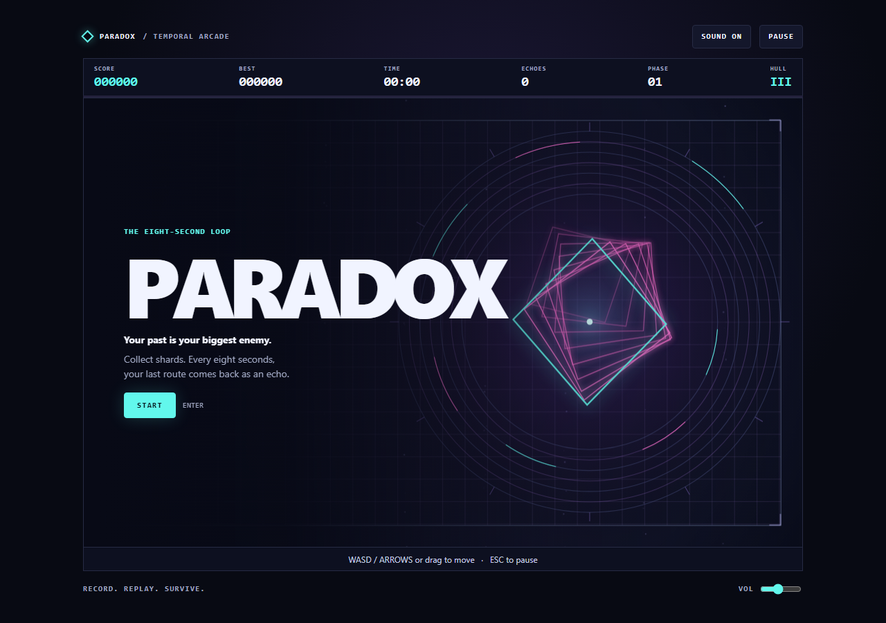

# PARADOX

**Your past is your biggest enemy.**

An eight-second arcade survival loop. Everything you do is recorded. At the end of each loop, a new echo repeats that exact route while you keep moving. Use those echoes to open gates and charge the core. A collision with your own history costs hull.

## Play locally

Open `index.html` directly in a modern browser. Select **START**. The full game is in that file and works offline.

| Input | Action |
| --- | --- |
| WASD or arrow keys | Move |
| Drag on the arena | Move with a floating touch joystick |
| Enter | Start, resume, or retry |
| Escape or P | Pause or resume |
| Sound and volume controls | Mute or adjust the procedural audio |

## How to play

- Collect cyan shards and gold prisms. Collect or link again quickly to build a multiplier up to ×5.
- In the first loop, cross a striped relay pad after your first shard. The echo will pass through the pad at the same moment in later loops.
- Stand on a different pad when an echo reaches its pad. The link scores points and opens moving gates.
- When two echoes occupy distinct pads, the central core charges. Reach it before the charge expires to score a bonus and recover one hull point if damaged.
- Red sweeps appear from phase 03. Use the highlighted gap or a circular shield bay. The second bay closes in phase 05.
- A dotted echo trail previews its next move. A close pass scores a graze. A hit breaks your combo and temporarily shields your hull.
- You start with three hull points. The game stores your top five runs locally and shows the top three at the end.

## Download budget

| Resource | Uncompressed bytes |
| --- | ---: |
| `index.html`, including CSS and JavaScript | 31,290 |
| Additional game resources | 0 |
| Competition maximum | 32,768 |
| Remaining allowance | 1,478 |

The internal planning target was 28,000 bytes. The shipped file keeps its source readable and fits the competition maximum. The page uses HTML, CSS, vanilla JavaScript, Canvas 2D, Web Audio and LocalStorage. The arena, graphics and sound are procedural. The game uses system fonts and has zero packages, frameworks, images, audio files, or remote assets. The screenshots and test script are repository documentation and the game never requests them.

## Verification

See [the test report](evidence/results.json), the [first echo](evidence/02-echo.png), the [emulated touch session](evidence/03-touch.png), and the [end of a run](evidence/04-results.png).

The report includes HTTP navigation bytes from a clean Chromium profile, runtime checks, frame timings and 24 automated runs across six styles. The runs used seeded gameplay and a 90-second observation cap. Browser checks exercised keyboard input, mobile touch emulation, pause and resume, audio initialization, mute and volume, offline play, and the console. The deterministic checks covered echo recording, gate collision, live and echo relay activation, echo chains, hull repair, hazards, score combos, game over and record storage.

Run `node qa.mjs` to reproduce the checks on Windows with a default Chrome installation and Node.js 22+. On other setups, pass the path to a locally installed Chromium browser as the first argument. The script starts a loopback HTTP server, uses a temporary browser profile, and writes screenshots and measurements to `evidence/`. The browser measurement represents that environment. Touch was emulated and the report contains no physical iOS or Android device testing.

## Publish on GitHub Pages

Create a new public repository, for example `paradox-game`. Put the contents of this project at the root of its `main` branch. Under **Settings → Pages**, select **Deploy from a branch**, then **main** and **/(root)**, and save. The `.nojekyll` file enables static serving.

Once GitHub reports a successful deployment, open the Pages URL in a clean browser with cache disabled. Start a run, move with the controls, and confirm the Network panel contains one document and no additional game requests. Compare the document’s decoded size against the budget above. HTTP transfer size on GitHub Pages will depend on its response compression and headers.
